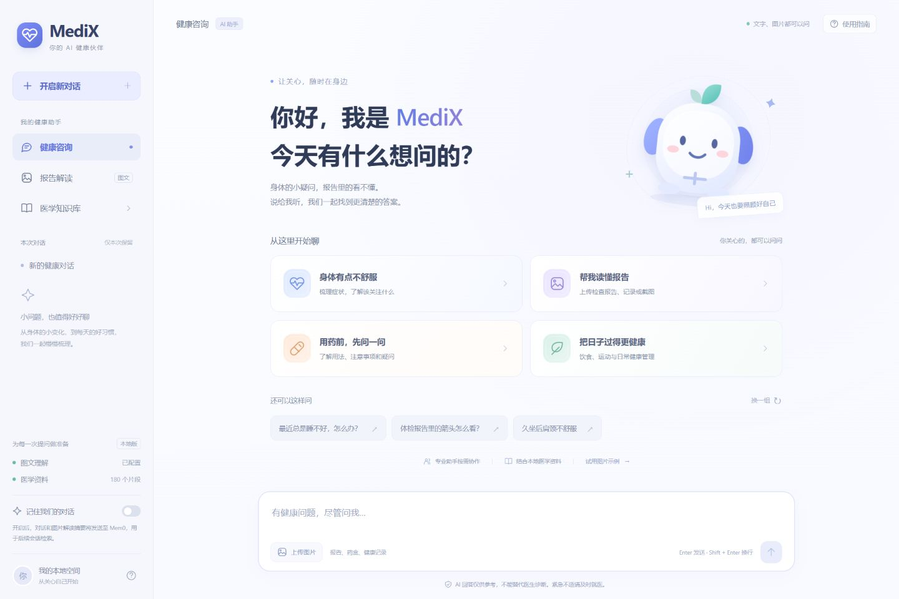

# MediX · 多 Agent 健康助手

MediX 是一个本地运行的健康问答项目，支持文字提问、图片解读、多轮追问、按需多 Agent 协作，以及本地医学资料检索。网页采用蓝紫色健康助手界面，也保留命令行入口。

回答由模型 API 生成；知识库使用本地向量模型进行检索。**项目没有模型训练或微调模块，启动和使用均不需要训练。** `torch`、`transformers` 和 `sentence-transformers` 用于检索向量的推理计算。

当前版本适合本地演示和开发。医学资料及模型回答需要核实，不能替代医生诊断。

## 技术栈与本版落地情况

按 Demo 题目梳理的技术栈如下。**题目涉及的组件不等于本版已经全部使用**，以下分别标明当前实现与待接入部分。

- **Agent：ReAct、Agent Swarm。** `core/agent_loop.py` 实现模型决策、工具调用、观察结果与继续推理的 ReAct 式循环；`swarm/` 实现任务分解、共享上下文及 Worker/SubAgent 协作。工具通过 Skills 注册给模型调用。
- **模型与检索：Qwen3.5-9B、医疗 VLM、MedEmbed、RAG。** 这是题目涉及的模型与检索方向；当前实际使用 `gpt-4.1-mini` 提供文字、图像理解及工具调用，使用 `BAAI/bge-small-zh-v1.5` 生成检索向量，结合本地检索片段构成 RAG。**Qwen3.5-9B、专用医疗 VLM、MedEmbed 均尚未接入或验证**；当前通用图文模型不应宣传为专用医疗模型。后续接入这些组件需要验证接口、能力和模型许可；更换嵌入模型还需要重建索引，不能直接复用不同模型的向量。
- **数据存储：Milvus、Redis、Mem0。** Milvus Lite 用于当前医学资料向量检索；Mem0 用于可选的跨会话摘要记忆。代码保留 Redis 短期记忆后端，但当前网页使用内存，未启用或验证 Redis 持久化。完整聊天历史保存尚未实现。
- **约束与安全：Harness Engineering、YAML 约束、输出自动修复。** `constraints/` 定义和验证 Agent 能力、允许工具及输出要求；`validation/auto_fixer.py` 对部分不合规输出进行修复；记忆模块提供去重、压缩等上下文管理。约束与自动修复不保证医学结论正确，也不等于完整安全认证。
- **网页与运行环境：Python 3.12、FastAPI、Uvicorn、Pillow、原生 HTML/CSS/JavaScript。** 提供本机网页、图片校验处理、异步任务提交及状态轮询；当前没有语音输入或逐 token 流式输出。



## 快速启动（Windows / Python 3.12）

### 账号与基础权限（本功能分支新增）

网页现在需要账号登录。首次运行前安装更新后的 `requirements.web.txt`，可运行 `python scripts/create_admin.py` 交互创建管理员；开发环境支持在 `/login` 注册普通账号。数据库迁移在网页启动前自动执行，也可手动运行 `python -m storage.migrate`。账号数据库默认保存到被 Git 忽略的 `.medix-data/app.db`。

首页可直接浏览，登录后才能提问。未登录时右上角显示“登录”；登录后通过左下角默认头像和用户名打开账号菜单，再进入账号设置或退出登录。注册时不需要选择头像，当前提供默认头像，尚未提供自定义头像上传。

登录采用服务端可撤销 Session、Argon2id 密码哈希、HttpOnly Cookie 和 CSRF 防护。账号设置及管理员用户启停通过左下角账号菜单打开居中弹窗，旧地址 `/account` 会转到首页弹窗。当前聊天任务、短期上下文和 Mem0 已按账号身份接入；完整历史持久化和私人知识库隔离仍需业务模块实现。每位开发者应设置独立 `MEDIX_IDENTITY_NAMESPACE`，防止共用 Mem0 环境时混用身份。

接口、迁移规则、配置、安全边界和各模块接入方式见 [用户认证对接文档](docs/AUTH-INTEGRATION.md)。以下原版功能说明中“无账户系统/按浏览器”等描述属于原版背景，以该对接文档中的本分支实现为准。

克隆本仓库后，在仓库根目录的 PowerShell 中执行：

```powershell
py -3.12 -m venv ..\.medix-venv
..\.medix-venv\Scripts\python.exe -m pip install -r requirements.web.txt
.\start_web.ps1
```

按隐藏提示输入模型 API Key，打开 http://127.0.0.1:8765/ ，等待知识库加载。Key 只用于进程，不随仓库提供。首次运行可能需要下载嵌入模型；保持启动终端运行，按 `Ctrl+C` 停止。

需要 Mem0 时运行 `.\start_web.ps1 -EnableMem0`，输入独立 Mem0 Key 并手动打开页面记忆开关。命令行入口为 `.\start.ps1`。不要同时运行多个共享同一 Milvus Lite 数据目录的实例。

- [医疗助手代码解读 Word 原件](docs/医疗助手代码解读.docx)：未修改原文，若与新版代码有差异，以代码及本 README 为准。
- [界面截图](web-ui-desktop.png)
- [交付包说明](DELIVERY.md)

## 网页可以做什么

- **文字问答**：描述健康疑问，继续追问本轮内容。
- **图片解读**：选择、拖入或粘贴 PNG、JPG、WebP；每次最多 3 张，每张不超过 8 MB。图片不能超过 2000 万像素。
- **报告追问**：读取图片后，可在当前对话中继续询问其中的记录和数值。
- **按需协作**：由现有路由决定单助手或多个专业助手参与；不是每次提问都调用全部 Agent。
- **检索参考**：回答下方展示实际检索到的本地文件名和资料片段；有工具调用时展示执行情况。
- **可选长期记忆**：通过 Mem0 保存和检索对话摘要，默认关闭。

首页的身体不适、报告解读、用药疑问和健康管理入口，都会进入同一套真实问答流程。推荐问题可“换一组”；“试用图片示例”会附加项目提供的**虚构血压记录**，仍需点击发送才提交分析。

医学知识库入口可查看资料说明；使用指南说明图片格式、操作方式与记忆规则。手机尺寸下通过左上角菜单打开侧栏。

## Demo 要求与演示对照

目标：**构建一个端到端 Agent，支持 SubAgent 机制，能够完成简单任务和复杂任务。** 以下按实际能力说明符合情况，不把未接入的指定模型列为已完成。

- **支持语音或者多模态输入：已实现文字 + 图片。** 题目中的输入要求通过图文多模态分支演示；若要求必须有语音或多种独立模型，则当前尚不满足该额外条件。可上传虚构血压记录，要求准确转录数字和单位，随后不附新图继续追问。
- **支持简单任务：已实现并实测。** 例如询问日常健康知识，或要求只读取报告中第二次测量值。路由可选择单个专业助手完成任务。
- **通过 SubAgent 机制支持复杂任务：已实现并实测协作路径。** LeadAgent 分解任务，健康咨询、症状分析和研究 Worker 在共享上下文中处理子任务并汇总。演示时使用明确包含风险梳理、生活方式与资料检索的虚构问题，检查实际参与 Agent 与工具记录；不是每次复杂提问都会触发全部 Worker。
- **可以挂载 Skills，完成复杂任务规划和调用：已实现。** 从 `.claude/skills/` 自动发现和注册业务技能，以 function calling 供 Agent Loop 选择执行；`deep-research` 还提供查询规划、网络搜索、本地检索与综合工作流。增加技能需提供相应定义和可调用脚本，不能只放一份说明文档就视为执行能力已接入。
- **支持检索公域和私域知识，有一定个性化：已具备基础能力。** 公域通过深度研究工具搜索网络资料；私域侧通过本地 Milvus 检索项目附带文档，可作为本地资料检索示例，但尚无网页上传并管理自建知识库的功能。个性化来自当前对话上下文及手动开启的 Mem0 摘要检索，不是完整个人健康档案或账户系统。

建议按下列顺序演示：

1. **端到端与简单任务**：网页输入一个问题，观察提交、检索和真实回答。
2. **图文输入与追问**：使用“试用图片示例”，读取三次记录，再询问第二次记录，核对是否沿用图片信息。
3. **SubAgent 与 Skills**：提交虚构复杂任务，如“请让症状分析和健康咨询助手分别梳理风险与日常管理，并查找相关资料”；核对实际路由及参与信息，资料不足时应说明。
4. **公域 / 私域检索**：分别检查本地文件引用，以及深度研究结果中的网络来源；不能仅凭网页本地参考卡片就宣称完成了网络搜索。研究工具的实际集成验证见 `verify_runtime.py research`。
5. **个性化**：在隔离的测试用户下使用虚构偏好验证 Mem0 写入和新客户端检索，并清理测试摘要；对应脚本为 `verify_mem0.py`。它不能证明完整聊天历史恢复，也不能代替换浏览器后的用户关联验证。

如果验收要求**必须使用 Qwen3.5-9B、专用医疗 VLM、MedEmbed 或 Redis**，这些仍是本版待完成的接入与验证事项；本版可以展示上述 Agent 流程，但不能声称已完整满足指定技术选型。

### 对话会保留吗

当前**没有历史会话列表，也没有刷新后恢复完整聊天的功能**。

- 当前页面内可连续追问；新建对话、刷新或重新打开页面后，不能恢复之前的完整聊天。
- 服务端短期上下文保存在内存，保留近期 6 条消息和图片读取文字，过期清理阈值为 1 小时；服务重启后丢失。
- 网页请求关闭本地会话总结落盘。命令行和其他直接使用 `SwarmCoordinator` 的入口，默认仍可写入 `memory/swarm/session_summaries/`，两者不能混为一谈。
- Mem0 保存的是可检索摘要，不是完整聊天记录、图片相册或历史会话列表。

## 从新环境安装

当前验证环境是 Windows + Python 3.12。以下命令在项目根目录执行，并按启动脚本的约定把虚拟环境建在项目上一级：

```powershell
py -3.12 -m venv ..\.medix-venv
..\.medix-venv\Scripts\python.exe -m pip install -r requirements.web.txt
.\start_web.ps1
```

`requirements.web.txt` 引用 `requirements.verified.txt`，并声明网页所需的 FastAPI、Uvicorn 和 Pillow。`requirements.verified.txt` 是已验证环境的完整依赖快照；`requirements.txt` 是核心功能依赖清单，两者用途不同。其他操作系统未完成验证。

首次使用本地嵌入模型 `BAAI/bge-small-zh-v1.5` 时需要下载模型或已有可读缓存。启动脚本把 `HF_HOME` 设置为项目上一级的 `.medix-model-cache`。不要在模型尚未缓存时启用 `HF_HUB_OFFLINE=1`。

## 模型与密钥配置

优先使用启动脚本的隐藏输入，不要把真实 Key 填入 README、前端代码或提交到版本库。

配置读取逻辑见 [`config.py`](config.py)：

1. 默认读取 `D:/AI training/config.py` 中的 `LLM_CONFIG`、`MEM0_CONFIG` 字面量赋值；不会执行外部文件代码。
2. 设置 `MEDIX_CONFIG_PATH` 可切换该外部文件位置。
3. 设置 `OPENAI_API_KEY` 时使用 OpenAI 兼容配置；模型默认 `gpt-4.1-mini`，地址默认 `https://api.openai.com/v1`。`OPENAI_MODEL` 和 `OPENAI_BASE_URL` 可覆盖。
4. 没有 `OPENAI_API_KEY` 时，使用 `ARK_API_KEY` 或外部 `LLM_CONFIG` 的密钥及模型配置。
5. `MEM0_API_KEY` 优先于外部 `MEM0_CONFIG` 的密钥。它与模型 API Key 分开配置。

更换外部配置路径的示例，不含密钥：

```powershell
$env:MEDIX_CONFIG_PATH = 'D:\my-config\config.py'
.\start_web.ps1
```

网页图片理解需要支持图像输入的模型；Agent 的工具调用需要模型支持相应的 function calling。当前实测模型为 `gpt-4.1-mini`，未验证所有兼容服务和模型。更改配置后需重启服务。

## 医学知识库在哪里

- 原文：[`knowledge/data/documents/`](knowledge/data/documents/)，当前有 10 个 TXT 文件。
- 旧版向量源数据：`knowledge/data/milvus_lite.db`。
- 当前向量库：由 [`runtime_paths.py`](runtime_paths.py) 决定，默认是系统临时目录下的 `medix-<项目路径哈希>/milvus_v3.db` **目录**。
- 当前迁移后的索引包含 180 条记录；原数据含重复片段，不能理解为 180 份独立医学文献。

启动时执行 [`migrate_legacy_db.py`](knowledge/scripts/migrate_legacy_db.py)，从旧库只读复制已有向量到新版目录；不会训练模型，也不会覆盖原始库。如果目标数量不符合迁移预期，脚本会报错而不是强行覆盖。

默认临时目录是为了规避 Windows 中文路径下的索引保存兼容问题。可通过 `MEDIX_DB_PATH` 指定其他**仅含 ASCII 字符**的持久路径；修改后重启服务。示例：

```powershell
$env:MEDIX_DB_PATH = 'D:\medix-data\milvus_v3.db'
.\start_web.ps1
```

这些资料是项目自带内容，**尚未核实其权威性、时效性与完整性**。展示检索来源不等于验证医学结论。不要为了解决启动问题反复运行原始导入脚本，以免重复导入；当前启动流程使用迁移脚本。

## 数据与联网范围

网页只监听 `127.0.0.1:8765`，用于本机访问，没有部署为公网服务。

- 图文提问及检索上下文会发送给配置的模型 API；“本地运行网页”不等于“所有数据都在本地计算”。
- 图片在服务端校验、纠正方向、压缩及去除元数据后用于分析，不写入服务器图片文件。
- 打开 Mem0 时，对话及图片解读的摘要会发送到 Mem0 服务；关闭时不启用该网页请求的长期记忆。
- 深度研究工具可能访问搜索服务及外部网页。
- 网页任务、短期上下文不做持久化；已有命令行总结和历史测试文件不会因打开网页而自动删除。

## 测试与维护

2026-10-28 最近一次网页改版验证中，7 项网页边界与上下文回归测试通过，并实际完成了示例图片识别、问答和本地资料检索。也检查了知识库弹窗、推荐问题切换和桌面/手机布局。这是指定环境中的验证结果，不代表所有模型、网络和部署环境都通过。

```powershell
# 项目根目录执行；不需要真实模型或 Mem0 Key
..\.medix-venv\Scripts\python.exe -m unittest web.test_web -v
```

真实 API、知识库及 Mem0 验证方式、外部调用和数据清理范围见 [`docs/TESTING.md`](docs/TESTING.md)。架构、目录、请求流程和常见故障见 [`docs/RUNTIME.md`](docs/RUNTIME.md)。

未完成验证或不在当前功能范围：模型训练/微调、历史会话恢复、Redis 持久化、独立 Qdrant 部署、其他模型提供商、正式临床使用与公网生产部署。

## 后续功能建议（尚未实现）

以下是基于当前代码和使用过程提出的改进方向，**不属于现有功能，也不表示已经排期开发**。优先补齐会话保留与日常使用体验，再完善稳定性、资料质量及报告解读；均不需要引入模型训练或微调。

### 优先级一：会话保留与日常使用体验

- **历史会话保存与恢复（首要）**：支持本机保存、重命名、切换及恢复会话，明确图片是否保存、保存在哪里，以及如何删除。与 Mem0 摘要分开设计；刷新、关闭页面或重启服务后仍应能够恢复聊天；当前尚未实现。
- **长期记忆管理**：在页面查看和删除已保存的 Mem0 摘要，说明保存内容与关联用户范围。关闭记忆开关仅停止后续使用，不应被描述为已删除此前云端记忆；删除需返回实际结果。
- **调用用量与费用估算**：按本轮展示模型请求次数、token 用量和实际参与的 Agent，帮助发现多助手重复调用。费用估算依赖可更新的价格配置和上游返回数据，不能将估算值作为账单。
- **语音输入与朗读**：提供可选的语音提问和回答朗读，保留文字确认及修正入口；启用前说明录音是否发往外部服务，并保留完整的键盘操作方式。

### 优先级二：让现有功能更稳定、更容易核实

- **启动自检与更明确的错误提示**：分别检测端口、知识库、模型连通性和鉴权状态；页面区分连接失败、额度不足、限流和超时，提供对应的处理提示。不要仅根据“已配置 Key”显示接口可用，日志也不能输出密钥或问题正文。
- **知识库管理页面**：支持查看文档、来源、发布日期、版本和审核状态，再逐步增加导入、更新及重建索引。原文与索引更新应同步，避免重复导入；自定义数据的更新流程应与当前恢复附带数据的迁移脚本分开。
- **更容易核对的引用**：回答中的引用标记可以跳到对应原文段落，展示真实来源和版本；缺乏资料支持时明确说明。检索到片段不应自动标为“权威”或“已验证”。
- **固定的问答回归集**：用虚构或公开测试样例覆盖图片数值、单位、模糊文字、多轮追问与资料引用，并在模型、提示词或知识库变化后检查。自动检查结合人工复核，不用“模型回答得通顺”代替正确性判断。

### 优先级三：改善提问与报告阅读体验

- **逐步输出与停止生成**：让用户及时看到回答进度，并能取消长任务。取消操作应尽量传递到后端和上游请求，不能只隐藏页面动画；已经发生的 API 消耗仍需如实记录。
- **结构化报告解读与用户校对**：将图片读取的项目、数值、单位、报告自带参考范围整理为可确认的字段，对模糊项标注“无法确定”；由用户确认后再继续分析，避免把识别错误带入后续回答。
- **多份报告对比**：在用户确认日期、项目与单位后，展示同一指标随时间的变化。不能直接比较单位、检测方法或参考范围不同的结果，也不应根据单项趋势自动作出诊断。
- **咨询小结导出**：导出本轮问题、已确认的报告信息、回答、引用和待补充事项，便于用户自己留存或就诊时说明情况。导出前允许预览并选择是否包含图片和个人信息。

建议下一步首先实现历史会话的保存、列表展示与恢复，再完善记忆管理、用量统计和语音交互。随后推进稳定性、资料质量和报告阅读体验的改进。

## 源码交付与打包

运行以下命令生成干净的 ZIP、SHA-256 校验文件和包内文件清单；Word 路径替换为实际文件位置：

```powershell
..\.medix-venv\Scripts\python.exe package_project.py --document 'C:\path\医疗助手代码解读.docx'
```

默认输出到项目上一级的 `delivery/`。包内 `DELIVERY.md` 提供解压后的启动步骤，`docs/医疗助手代码解读.docx` 保留用户提供的原始代码解读文档。Word 内容未自动更新，如与新版实现不一致，以源码及本 README 为准。

交付包包含源码、界面、文档、启动脚本、测试代码、项目附带知识库 TXT 与旧向量源数据。排除密钥、外部配置、依赖环境、模型缓存、运行日志、会话记录及验证输出；打包前进行凭证格式扫描，打包后校验文件哈希。文件已存在时拒绝覆盖，避免误替换先前交付包。

## 代码导航

- 网页启动：[`start_web.ps1`](start_web.ps1)、[`start.ps1`](start.ps1)、[`run_web.py`](run_web.py)
- 网页 API：[`web/app.py`](web/app.py)
- 界面及交互：[`web/static/`](web/static/)
- 协作路由：[`swarm/swarm_coordinator.py`](swarm/swarm_coordinator.py)
- 专业 Agent：[`agents/`](agents/)
- 模型调用、Agent Loop 和工具注册：[`core/`](core/)
- 可发现的业务技能： [`.claude/skills/`](.claude/skills/)
- 知识库、记忆、搜索研究：[`knowledge/`](knowledge/)、[`memory/`](memory/)、[`research/`](research/)
- 运行时约束及输出修复：[`constraints/`](constraints/)、[`validation/`](validation/)

原项目 README 声明使用 MIT License；本次整理未修改授权声明。
