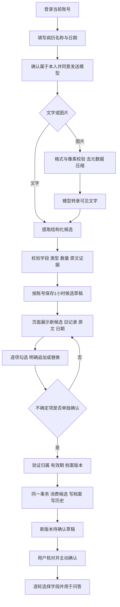
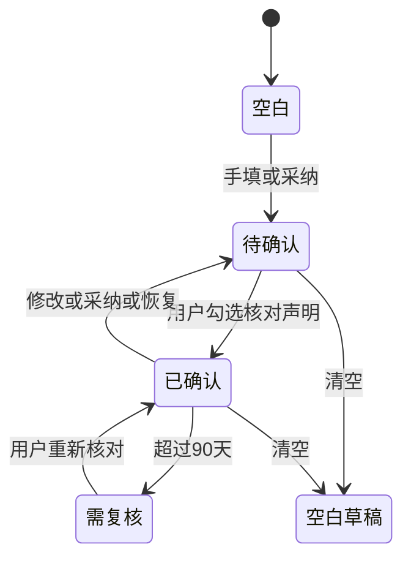

# 个性化功能技术流程文档 v2

## 对话更新流程（2026-10-30）

用户问答 → 回答旁点击“从本次描述更新健康档案” → 预填用户本轮原话（不含助手回答）
→ 主动确认本人实际经历及模型整理授权 → 逐事实分类归属、肯定/疑似/否定/假设与信息依据
→ 保守规则复核 → 澄清问题或生成带原话证据的候选 → 用户逐项采纳 → 新草稿 → 主动确认。

实现位于 `personalization/conversation_updates.py`，复用原有临时候选、版本锁、采纳事务、历史记录和确认机制。
个人档案新增“症状与近期身体状况”，不将普通不适升级为确诊。
无法证明用户描述的客观真实性；来源只能声明“用户自述、未经医学核实”。
归属不明或疾病为模型推断时不写入；对第三人、假设、否定语句还有服务端保守拦截。
规则可能错过复杂或混合句子的真实信息，此时应拆分、澄清原话或手工填写，不能以猜测补齐。
疑似内容单独确认后也仍标不确定；修改后的档案不能立刻绕过本轮使用开关。

测试命令在原命令后加：
`personalization.test_conversation.ConversationGuards personalization.test_conversation.ConversationAPI`。
联合66项自动测试通过，使用临时数据库与模型替身。分类不构成医学真实性验证或诊断。

## 目标与范围

在现有账号体系、健康档案和病历图片分析管线上增加：病历候选提取、原文依据、日期来源、
新旧对照、逐项采纳、版本恢复、当前档案导出和逐轮字段授权。
候选不是诊断，也不是已确认的个人档案；历史病历不代表当下情况。

本地分支为 `health-profile-evolution`，基于之前已验证的个性化分支提交 `167ec3f`。
没有新建登录系统，没有推送到远程，没有修改main。

## 模块边界

| 模块 | 职责 |
| --- | --- |
| auth/ | 账号、会话、CSRF，原有能力直接复用 |
| personalization/schemas.py | 档案、来源与恢复命令的数据校验 |
| personalization/models.py | 当前档案、历史版本、临时候选表 |
| personalization/store.py | 乐观锁写入、确认、清空、历史与恢复 |
| personalization/report_imports.py | 提取服务、候选归属校验与原子采纳 |
| personalization/context.py | 字段裁剪、检索查询、带边界的模型上下文 |
| personalization/memory_tools.py | 将历史工具绑定到本轮允许的记忆客户端 |
| web/static/health-profile.js | 手工档案编辑、确认、逐轮字段授权 |
| web/static/profile-evolution.js | 上传、候选对照、采纳、历史恢复和导出界面 |
| web/app.py | 路由挂载、聊天入口与现有Agent管线的最小接入 |

## 病历建档流程



提取接口不接受客户端候选值。候选值由服务器模型输出，经结构校验后保存；采纳请求只接受候选ID与操作选择。
模型证据必须是用户上传文字或图片转录中的原文子串，不匹配则整个提取失败。
OCR可能识别错误，子串匹配不能代替人工核对。界面保留不确定标记，疑似/待排等需额外确认。
旧病历用药固定为historical或unknown，不会由模型自动写成current。
图片仅用于请求内转录，不落盘。数据库只保存候选值、证据片段和来源日期，不保存整张图片或整篇转录。

## 冲突与事务

候选记录携带base_revision，采纳请求携带expected_revision，两者必须与当前档案一致。
提取前后都检查版本，避免模型处理期间其他窗口修改档案后产生错误对照。
采纳时重新检查归属、过期、已消费标志、版本与目标下标；不能重复采纳或用ID覆盖其他账号。

基础字段年龄、性别只支持明确替换。列表支持追加或指定原条目下标替换；
同名记录不能直接追加，必须明确选择替换，或不采纳并回到手工档案中调整。
同一旧条目每次只可替换一次，单次不能把刚追加的条目当作替换目标。

候选消费标志CAS更新、当前档案CAS更新和版本记录写入处于同一数据库事务；任一失败整体回滚。
数据库唯一键防止并发创建同一账号的首份档案。用户身份只来自require_user，不信任模型或前端提供的用户ID。

## 档案状态机



每次修改产生递增版本并撤销确认；确认操作更新该版本的确认时间。
恢复旧版不倒退版本号、不继承旧确认：复制旧内容为新草稿，用户必须重新确认。
清空移除之前历史中的健康内容和所有候选，仅保留新的空白版本，以防旧请求复活。
导出仅包含当前档案与版本状态，不包含登录凭证、整篇病历、其他账号数据或Mem0内容。

## 选择字段后的RAG管线

1. 前端提交use_profile、profile_revision和profile_fields，不提交档案正文。
2. 服务端从当前账号读取已确认档案，验证版本及复核状态。
3. 将未授权字段替换为空白默认值，同时剔除这些字段的来源信息。
4. 排队任务启动后重新验证版本与确认状态，再按同一字段范围裁剪。
5. 以本轮问题和图片读取内容为主体，附加有限的授权档案术语用于公共知识检索。
6. 给模型注入带版本、确认时间、授权字段与原文来源的历史背景，明确不能当作实时诊断。
7. 当前陈述和旧档案冲突时要求澄清，不自动覆盖档案；本轮分析不触发档案写入。
8. 结果返回profile_used、profile_revision、profile_confirmed_at、profile_fields，页面显示实际使用范围。

不同字段组合纳入上下文scope；用户取消勾选或改变范围时，不继续沿用此前含其他字段的模型回答和图片观察。
底层ShortTermMemory是进程单例，网页调用协调器前后都清理对应会话；跨轮历史只来自网页过滤后的上下文。
历史检索工具使用本轮允许的会话与账号绑定客户端，不能自行创建默认用户记忆客户端。
使用档案的轮次暂停Mem0读写，防止结构化档案被另存为失去确认状态的记忆副本。

## 存储与迁移

迁移顺序：`20261029_01`账号 → `20261029_02`当前档案 → `20261029_03`历史与候选。

| 表 | 主键/归属 | 内容 |
| --- | --- | --- |
| health_profiles | user_id | 当前ProfileData、revision、updated_at、confirmed_at |
| health_profile_revisions | user_id + revision | 保存快照、保存/确认时间、操作类型 |
| health_profile_imports | id，user_id外键 | base_revision、候选JSON、创建/失效时间、消费标志 |

升级时把原有当前档案回填为baseline，保留年龄等旧字段，新增来源字段使用默认空值。
不存在的历史不能回填。多开发者并行增加Alembic迁移时，应创建merge revision，不能随意改已执行版本。
正式共享部署应先单独执行迁移；本地启动仍沿用应用lifespan自动升级。

```powershell
cd E:\xiaoyitraining\medix-agent-swarm-20261028
& ..\.medix-venv\Scripts\python.exe -m storage.migrate
```

候选1小时后不能再使用；下一次提取时会物理清理已过期记录，或由本人主动丢弃。
这是请求触发清理，不是定时删除服务。历史版本无自动清理周期，可由清空档案删除历史内容。

## 验证方式

```powershell
& ..\.medix-venv\Scripts\python.exe -m unittest auth.test_auth web.test_web personalization.test_profile personalization.test_evolution.EvolutionTests -v
```

测试使用临时数据库、虚构账号和模型替身，重点覆盖：

- 候选提取不写档案；仅选中项进入草稿；来源日期保留；不确定项单独确认。
- 重复消费、过期、旧版本、重复ID、错误下标和同名追加被拒绝。
- A/B账号隔离；不能通过他人候选ID或历史版本号读写。
- 恢复产生新草稿；导出只含当前账号；清空删除历史内容与候选。
- 未授权字段不进入实际KB查询和模型上下文，字段scope变化隔离旧历史。
- 模型捏造证据被拒绝；旧药物不会自动标为当前使用。
- 原有登录、CSRF、网页边界、上下文与档案授权回归继续执行。

浏览器手测建议：用一份明确标记虚构的病历文字，完成提取、对比、仅采纳部分项、重新确认、
只授权一个字段提问、查看历史并恢复，再换另一账号验证看不到前者内容。
真实模型调用需单独验证；自动测试不能证明模型医学判断、图像识别或外部Mem0正确性。

## 当前限制与后续方向

支持病历文字及PNG/JPEG/WebP图片，不含PDF/Word解析；不支持直接共享家属档案。
来源是用户声明与上传文字，不是可信医疗机构签名；所有字段仍需本人核对。
复核提醒目前为整份档案90天，尚未实现按药物或过敏条目的独立复核周期。
没有建立私人病历全文向量库；现有Milvus依旧只有公共知识，不混存私有候选。
已经发到模型的请求不能追回；关闭窗口不保证取消已发生的模型调用或费用。
未来可在来源验证、字段级复核、分页审计、私人文档权限与可量化检索效果评估上继续完善。

## 本次验证记录（2026-10-29）

59项联合测试通过，前端三份业务脚本通过node语法检查。
真实DeepSeek文字提取与浏览器流程已验证：虚构病历产生五类候选，只采纳过敏条目后生成v2待确认草稿，
保留原文与2020-01-01来源日期；其他未选字段未导入。页面加载了升级前v1基线与v2历史，
恢复v1后生成v3待确认草稿，没有继承旧确认。测试操作仅修改独立虚构验收账号。
图片模型转录路径具备格式校验与错误处理，但本次没有用真实图片完成端到端模型验收。

对话更新真实接口验证（2026-10-30）：混合本人头痛、父亲糖尿病、假设高血压的输入返回201，仅生成symptoms候选；提取前后的档案完全一致。测试候选已丢弃，未修改验收账号档案。

对话候选内嵌选择优化：回答下方展示授权与候选勾选面板，不再要求离开对话打开档案编辑弹窗。候选默认不选择，只有勾选项会发到采纳接口；不自动保存或确认。“暂不加入”会丢弃本轮候选。前端交互逻辑测试验证了未授权不请求、默认不选不保存、仅发送选中项和不自动确认。


## 档案对回答的作用（2026-10-30）

仅在本人咨询、主动勾选、档案已确认且版本有效时启用。字段授权和历史隔离规则保持生效。
检索同时使用“本次问题及附件”和“本次问题及带状态的档案背景”，交替合并、去重，沿用相关性阈值与三条引用上限。
检索关键词标注病史、过敏、用药、既往症状及其状态，已停药不会作为当前用药描述。
回答提示要求把相关记录与具体建议对应，简短说明档案如何改变关注点、建议选择或需核查风险；
历史记录不当作当前事实，不相关或空档案不强制制造个性化差异，纯转录不插入档案分析。
接口字段保持兼容，profile_used 表示已注入授权背景，不保证模型每次都采纳或医学判断正确。

验收建议：使用虚构测试账号，在同一问题下分别关闭档案、只授权过敏、授权病史和用药，观察回答依据和针对性追问。
检查未授权内容不出现、已停药不写成正在服药、旧症状不当作当前症状；无关问题无需硬套档案。
自动测试覆盖提示构建、记录状态、字段裁剪和原有授权隔离，实际生成差异仍需真实模型对照验收。


## 结合本轮回答追加待核实事项

POST /api/profile/conversation-candidates 新增可选 job_id：不传时只整理用户原话；传入时读取本账号已完成且 request_text 与 text 一致的回答。
找不到或不属于本账号返回404，未完成或原话不匹配返回409；任务过期或服务重启后需重新提问。
前端“同时参考本轮回答”默认关闭，用户主动授权后才发送所选回答给模型。
新增 profile.data.followups（status/items结构）和可授权字段 followups，旧档案自动补为空，无需数据库列迁移。
助手回答只可生成 followups 候选，来源 kind=assistant，保留回答原文证据；不能补全用户事实、诊断或当前药物。
候选强制 uncertain=true/status=unknown，必须逐项勾选并额外确认后才能采纳，仍需重新确认整份档案。
档案新增“建议与待核实事项（非病情事实）”分区。后续问答仅把它当待核实建议，不作为病史或已执行事项；公共知识检索不把建议当作症状关键词。
测试：本人描述“我这两天头痛”，本轮回答含观察或就医建议，选择参考回答→筛选→仅选建议→额外核对→保存；检查仅followups变化且档案为草稿。
同时验证关闭参考回答不生成助手建议、他人任务404、不匹配原话409、未额外确认422、未选候选不保存。


## 回答偏好（与健康档案独立）

GET /api/profile/reply-preferences 返回 {data, revision, updated_at}；首次默认enabled=false。
PUT 同路径，提交 {expected_revision, data}，需要登录、可信Origin及CSRF；版本冲突409、非法字段422。
data字段：enabled(bool)、nickname(最多20字)、tone(neutral/supportive/direct)、detail(brief/standard/detailed)、
format(summary_first/steps/explanation)、terminology(plain/professional)、communication_note及daily_context(各最多200字)。
用户身份只来自服务端会话；不同账号互不可见。恢复默认通过PUT保存默认值、清空文本并关闭enabled，版本继续递增。
使用独立reply_preferences表，迁移20261030_04；旧用户默认为关闭，不改变健康档案或其确认状态。
后端分析时读取当前账号偏好，只影响表达与执行建议的安排，不用于医学知识检索，不作为病史，不能绕过档案开关。
自由文本作为低优先级数据处理，本轮明确要求和必要风险提示优先；不提供真人医生角色或诊断身份设定。
启用时暂停云端记忆，避免将称呼、日常安排等随增强提示保存到Mem0；修改或关闭偏好时隔离旧上下文。
任务结果新增reply_preferences_used、reply_preferences_revision和memory_suppressed_for_preferences；不返回偏好文本。
前端入口“回答偏好”，默认不开启，显式保存后下次提问生效。设置页面不在localStorage保存文本；切换账号会清理弹窗。
验收：分别设置“简短重点＋分步骤”和“详细说明＋解释原因”，同一问题比较；再关闭偏好、换账号和关闭档案验证隔离。
自动化覆盖持久化、版本冲突、身份/CSRF、字段校验、真实提示注入链路、检索排除、档案不写入和关闭后历史隔离；实际模型风格需单独验收。


回答偏好真实验收（2026-10-30）：独立虚构账号保存“小林／温和鼓励／简短重点／分步骤／每次5分钟”。
浏览器发问“如何把日常散步安排进繁忙的工作日？”，真实模型回答采用“小林”称呼，并围绕5分钟安排给出三个步骤；
结果注明未使用健康档案、已使用回答偏好。简短模式是长度目标，模型包装及必要说明可能超出目标字数。
桌面与390px窄屏显示、保存后重新读取已验证；验收后恢复默认并关闭测试账号偏好。


## 回答偏好最终呈现修复

偏好必须启用并保存，对下一次新提问生效，不会改写已有回答。固定咨询助手模板可能弱化增强提示中的偏好，
因此在所有助手完成后增加独立最终呈现步骤，使用系统级表达要求重新组织原答复，昵称有显式兜底。
简短目标120—220字（必要风险可能超出），详细在问题需要时目标700—1000字；不能为凑长度添加医学事实。
本轮明确要求优先，不能删去关键风险、就医提示、用药限制或不确定性；不机械截断文本。
该步骤增加一次模型调用（最大约38秒），失败或输出截断则保留完整原答复并显示偏好整理失败，不能声称已完整应用。
结果新增reply_preferences_status=off/applied/fallback，以及reply_preferences_detail；前端显示版本和所选详略。
模型排版不能保证逐字数精确或完全语义等价，仍需真实对照验收，尤其关注简短模式是否保留必要风险。


最终呈现真实对照验收：同一虚构账号、同一会话、同一问题“如何把日常散步安排进繁忙的工作日？”，
先保存小禾+brief(v3)，最终回答以“小禾”开头、去空白211字符；再保存小岚+detailed(v4)，最终回答以“小岚”开头、765字符。
两轮结果均显示applied及对应版本/详略，未使用健康档案。90项自动化检查通过；测试后恢复默认关闭。
长度统计包含标点，长度目标不构成严格字数承诺；最终整理增加一次模型调用，不能证明所有医学内容等价或适用于真实个人。


## 防止无关条目覆盖

列表型档案候选仅允许更新同名记录（名称做NFKC、去空白、转小写规范化）；不同症状/疾病默认追加。
如“感冒”与现有“头痛”互不替代。前端只列同名更新选项，后端对跨名称替换返回422且不消费候选。
同名重复追加同样返回422，需明确选择更新同名项；昵称别名、近义疾病不自动归并，可在档案中人工核对整理。
年龄、性别仍为基础字段明确替换，不受列表规则影响；该规则同时覆盖对话候选和病历导入。
