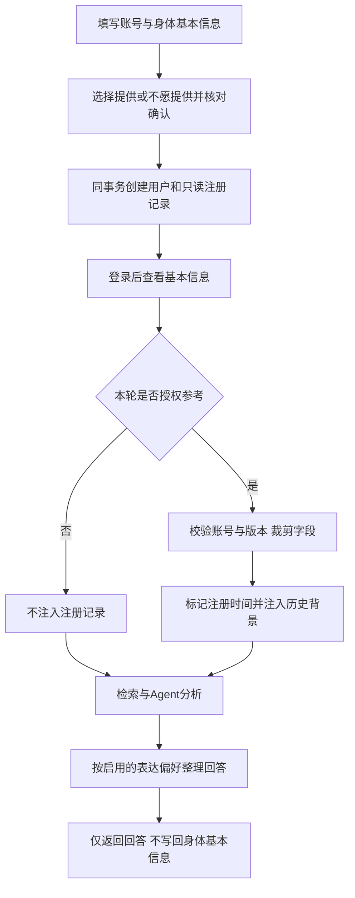

# 个性化技术流程 v4：注册时一次建档

更新日期：2026-10-31；分支feature/health-profile-evolution。

## 用户流程

注册账号时填写年龄、性别、身高、体重，可留空或选择不愿提供；用户勾选核对声明后注册。
注册成功后再登录，点击“我的基本信息”只读查看注册记录。每轮主动选择是否参考及字段范围。
不询问病史、过敏、用药，不再提供病历提取、聊天追加、编辑或恢复入口。



## 实现与边界

- personalization/body_schema.py：注册输入校验，不依赖认证模块，避免循环导入。
- auth/schemas.py、router.py：注册接口接收并要求basic_profile及主动确认。
- auth/service.py：flush取得用户ID，同事务插入用户与注册记录；重复账号失败回滚。
- personalization/models.py：RegistrationProfile独立模型，user_id为主键和外键，一账号一条记录。
- 迁移20261031_05：仅创建registration_profiles，不迁入、删除或覆盖旧病情档案。
- personalization/registration_profile.py：仅挂载GET /api/profile，提供只读存储适配、授权裁剪和上下文构造。
- web/app.py：问答读取改为注册记录，停止挂载旧档案、提取及对话更新路由。
- web/static/login.js：注册表单增加四项和核对声明，登录模式隐藏这些字段。
- web/static/registration-profile.js：只读弹窗、记录日期和逐轮字段授权；替代原编辑脚本。
- web/static/app.js：移除回答后的档案写入卡片。表达偏好仍独立可改。

## 时间、隐私与旧账号

年龄、身高、体重均为注册时自述，不代表当前数值，不能据此断言疾病或调整为当前状态。
本轮明确描述优先，模型可以询问当下数值但不能保存更新；不提供字段视为未知。
每轮授权默认关闭，未授权字段不进入检索及档案上下文；本人咨询限制和账号隔离保持生效。
旧账号显示“未在注册时记录基本信息”，不自动从病史提取或增加登录后补填，旧数据保留在原表。
如后续需要旧用户一次补录、纠错或删除流程，应另行明确需求，本次不自动扩展。

## 验证

```powershell
E:/xiaoyitraining/.medix-venv/Scripts/python.exe -m unittest personalization.test_registration_profile.RegistrationProfileTests -q
node --check web/static/login.js
node --check web/static/registration-profile.js
node --check web/static/app.js
```

覆盖注册原子性、重复账号、字段范围、拒绝病情字段、核对要求、全不提供、账号隔离、只读接口、旧账号不迁入及聊天授权字段裁剪。
旧档案演进的写接口已退役，其测试预期与本版不兼容，不能把旧全量结果当成本版验收。
页面验收：注册模式只含一般情况；登录模式不显示注册问题；注册成功后查看记录日期及四项只读值；问答结束无更新入口。
