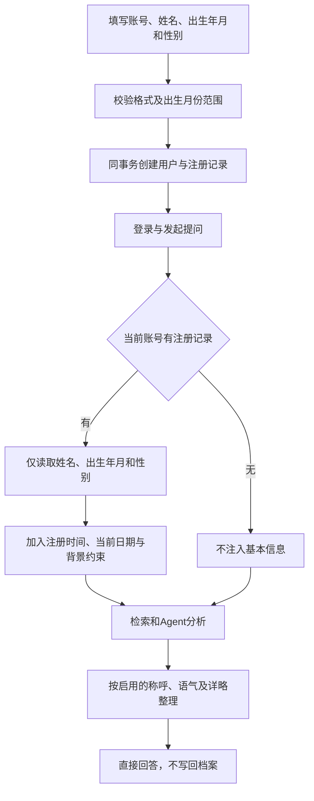

# 个性化技术流程 v4：注册基本信息

更新日期：2026-10-31；分支 `feature/health-profile-evolution`。

## 用户流程

注册时仅填写姓名、出生年月和性别，均可不提供。注册后登录，通过“我的基本信息”只读查看；问答默认参考已有信息，不再询问授权、追问或更新档案。回答偏好独立编辑与启用。



## 实现

- `personalization/body_schema.py`：出生年月格式及范围校验、性别枚举，拒绝额外字段。
- `auth/schemas.py`、`auth/router.py`：公开注册要求basic_profile对象，不要求核对勾选。
- `auth/service.py`：flush取得用户ID，同事务写入用户与注册记录，失败回滚。
- `personalization/models.py` 与迁移 `20261031_05`：独立registration_profiles表，一账号一条记录。
- `personalization/registration_profile.py`：只读GET接口、按账号读取、白名单过滤、兼容字段裁剪、检索与上下文构造。
- `web/app.py`：默认读取当前账号基本信息，停止挂载旧档案写入路由。
- `personalization/answer_policy.py`、`reply_render.py`：统一直接回答约束，偏好整理不得重新添加追问。
- `web/static/login.js`：仅在注册模式显示出生年月与性别，出生年月使用month输入控件。
- `web/static/registration-profile.js`：三项只读展示；`web/static/app.js`：回答中显示引用信息，不提供档案更新入口。

## 边界与兼容

出生年月不是注册时年龄；允许结合当前日期估算年龄，但缺少出生日，不编造具体生日。基本信息不能证明当前病情。本轮明确询问他人或假设场景时不得套用本人背景。

旧记录只保留性别可读取，历史年龄、身高和体重被读取白名单排除，不从年龄反推出生年月；原始数据仍保留在数据库。不从旧病史迁入，不新增补填或更新接口。

未提供信息视为未知；回答说明适用条件，不主动要求补充或确认。保留必要的风险及紧急就医提示。本轮自述不写入档案，也不声称已记录。

接口保留use_profile=false及三字段裁剪兼容能力，页面默认使用。上下文按账号和范围隔离；有基本信息或启用偏好时暂停云端记忆。

## 验证

```powershell
E:/xiaoyitraining/.medix-venv/Scripts/python.exe -m unittest personalization.test_registration_profile.RegistrationProfileTests personalization.test_preferences.FinalPresentationTests -q
node --check web/static/login.js
node --check web/static/registration-profile.js
node --check web/static/app.js
```

覆盖原子注册、字段校验、旧字段拒绝、可全部不提供、账号隔离、只读接口、旧字段读取过滤、默认引用与范围裁剪，以及偏好整理。浏览器核对注册表单只含姓名、出生年月和性别、登录模式隐藏字段。

旧档案演进写接口已退役，其测试预期与本版契约不兼容。模型实际输出仍需端到端验收，单元测试验证约束传递及数据隔离。

## 姓名与账号持久保存

`name` 为可选姓名，最多50字符，去除首尾空格，空值保存null，拒绝控制字符。姓名随出生年月、性别在注册事务中写入registration_profiles，以服务端user_id为唯一主键绑定账号；退出、重新登录及服务重启后按同一账号读取，不依赖浏览器临时缓存，也不接受客户端指定其他档案所有者。旧账号姓名缺失时显示未提供，不推断、不自动补录。

姓名用于只读展示及自然称呼；已设置回答偏好称呼时优先偏好。姓名不参与医学检索，也不用于推断身体状况。新增双账号、重新登录、重新建立数据库连接及伪造user_id查询的持久保存与隔离验证。
