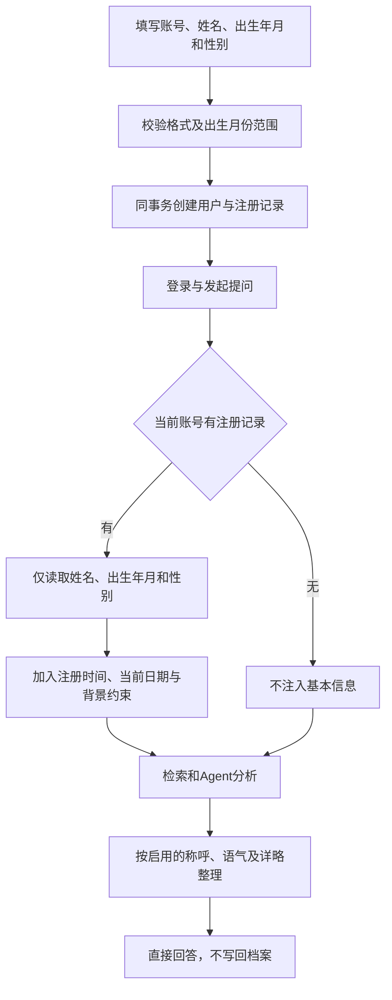

# 个性化技术流程 v4：注册基本信息

更新日期：2026-10-31；分支 `feature/health-profile-evolution`。

## 用户流程

注册时仅填写姓名、出生年月和性别，均可不提供。注册后登录，通过“我的基本信息”只读查看；问答默认参考已有信息，不再询问授权、追问或更新档案。回答偏好独立编辑与启用。



## 实现

- `personalization/body_schema.py`：出生年月格式及范围校验、性别枚举，拒绝额外字段。
- `auth/schemas.py`、`auth/sms_router.py`：手机号注册要求basic_profile对象，不要求核对勾选。
- `auth/service.py`：flush取得用户ID，同事务写入用户与注册记录，失败回滚。
- `personalization/models.py` 与迁移 `20261031_18`：独立registration_profiles表，一账号一条记录。
- `personalization/registration_profile.py`：只读GET接口、按账号读取、白名单过滤、兼容字段裁剪、检索与上下文构造。
- `web/app.py`：默认读取当前账号基本信息，停止挂载旧档案写入路由。
- `reply_render.py`：沿用 main_copy 的回答偏好整理和语音设置；图片报告沿用结构化 report_reader 流程。
- `web/static/phone-register.js`：手机号注册表单显示姓名、出生年月与性别，出生年月使用month输入控件。
- `web/static/registration-profile.js`：三项只读展示；`web/static/app.js`：不再展示基本信息与回答偏好使用说明，保留后端实际应用逻辑，不提供档案更新入口。

## 边界与兼容

出生年月不是注册时年龄；允许结合当前日期估算年龄，但缺少出生日，不编造具体生日。基本信息不能证明当前病情。本轮明确询问他人或假设场景时不得套用本人背景。

旧记录只保留性别可读取，历史年龄、身高和体重被读取白名单排除，不从年龄反推出生年月；原始数据仍保留在数据库。不从旧病史迁入，不新增补填或更新接口。

未提供信息视为未知；回答说明适用条件，不主动要求补充或确认。保留必要的风险及紧急就医提示。本轮自述不写入档案，也不声称已记录。

接口保留use_profile=false及三字段裁剪兼容能力，页面默认使用。上下文按账号和范围隔离；有基本信息或启用偏好时暂停云端记忆。

## 验证

```powershell
E:/xiaoyitraining/.medix-venv/Scripts/python.exe -m unittest personalization.test_registration_profile.RegistrationProfileTests personalization.test_preferences.FinalPresentationTests -q
node --check web/static/login.js
node --check web/static/registration-profile.js
node --check web/static/app.js
```

覆盖原子注册、字段校验、旧字段拒绝、可全部不提供、账号隔离、只读接口、旧字段读取过滤、默认引用与范围裁剪，以及偏好整理。浏览器核对手机号注册表单增加姓名、出生年月和性别，普通登录表单不显示这些字段。

旧档案演进写接口已退役，其测试预期与本版契约不兼容。模型实际输出仍需端到端验收，单元测试验证约束传递及数据隔离。

## 姓名与账号持久保存

`name` 为可选姓名，最多50字符，去除首尾空格，空值保存null，拒绝控制字符。姓名随出生年月、性别在注册事务中写入registration_profiles，以服务端user_id为唯一主键绑定账号；退出、重新登录及服务重启后按同一账号读取，不依赖浏览器临时缓存，也不接受客户端指定其他档案所有者。旧账号姓名缺失时显示未提供，不推断、不自动补录。

姓名用于只读展示及自然称呼；已设置回答偏好称呼时优先偏好。姓名不参与医学检索，也不用于推断身体状况。新增双账号、重新登录、重新建立数据库连接及伪造user_id查询的持久保存与隔离验证。

## 回答偏好

冲突按 main_copy 处理，保留启用开关和语音试听；勾选并保存后生效，恢复默认可关闭。已有回答不自动改写。

界面入口更新：“我的基本信息”位于左下角账号菜单，与账号设置并列；输入框上方不再展示基本信息入口或状态条。“回答偏好”位于上传图片旁，原只读档案与按账号隔离逻辑保持不变。

## 报告图片读取修复（2026-10-31）

原图片转录使用1400 token且未检查完成状态，DeepSeek默认思考模式可能耗尽预算，返回只有标题的部分正文。来源分支新增的独立辅助模块web/vision.py：仅对DeepSeek官方接口关闭转录阶段思考，转录预算4096，finish_reason=length时以8192重试；空结果、受限结果及持续截断明确报错，不将部分转录交给问答。保留原图片像素校验、元数据清除、账号隔离和只读档案约束。

验证命令：python -m unittest web.test_vision web.test_web personalization.test_registration_profile.RegistrationProfileTests -q。真实报告附件另做接口实测；不将病历原图或转录内容提交到仓库。

集成入口仍使用 main_copy 的 web/report_reader.py 结构化报告读取，未切换到 web/vision.py。上述转录重试仅为辅助模块的离线验证，不表示实际报告入口已使用该模块。
