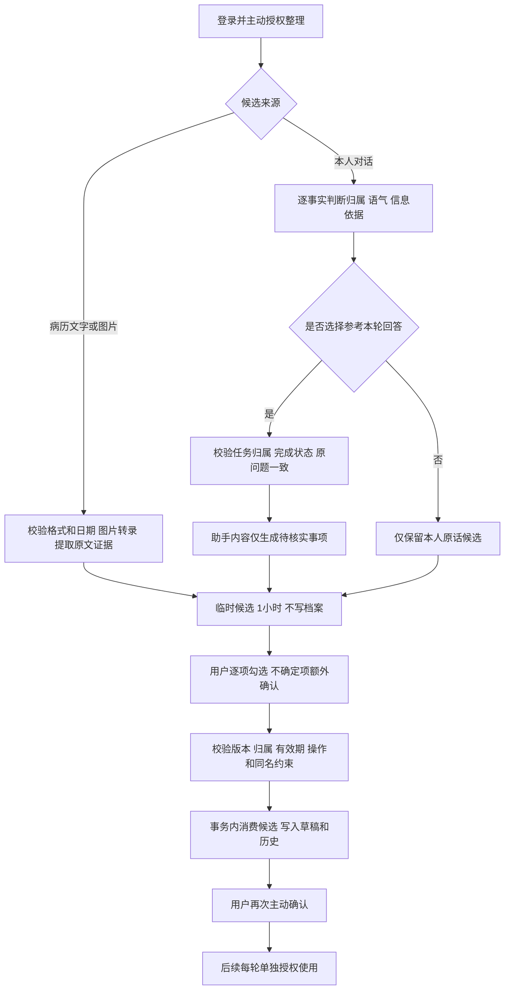
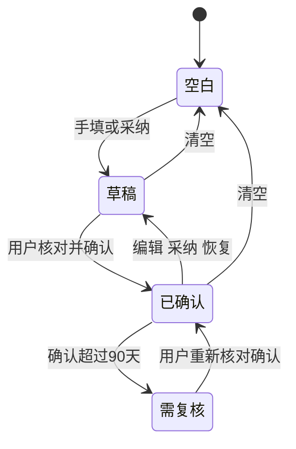
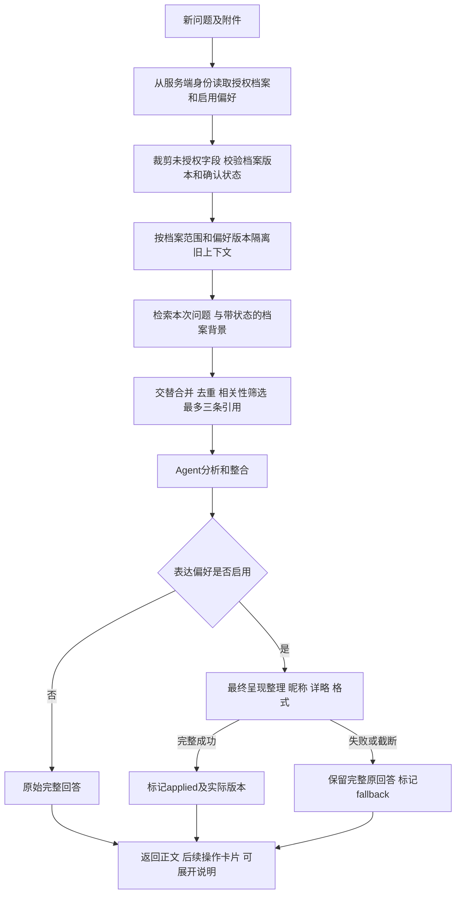

# 个性化功能技术流程文档 v3

更新日期：2026-10-30。对应`feature/health-profile-evolution`当前实现，接口细节见[接口文档](PERSONALIZATION-API.md)。
本文是当前流程说明，替代早期增量记录中的旧按钮名称、六字段范围与任意条目替换描述。

## 模块与数据边界

| 模块 | 职责 |
| --- | --- |
| auth/ | 沿用原有用户、登录会话、CSRF能力 |
| personalization/schemas.py、models.py | 七类档案字段、来源、当前档案/历史/临时候选/回答偏好模型 |
| personalization/store.py | 乐观锁写入、历史、确认、恢复与清空 |
| personalization/report_imports.py | 病历提取、候选读取、原子采纳及同名更新校验 |
| personalization/conversation_updates.py | 自述归属和语气判定、本轮助手建议候选 |
| personalization/context.py | 字段裁剪、带状态检索背景与档案使用要求 |
| personalization/preferences.py | 按账号保存偏好、默认关闭、表达上下文 |
| personalization/reply_render.py | Agent完成后的最终表达整理、昵称处理与失败回退 |
| personalization/memory_tools.py | 限定本轮历史与记忆工具访问 |
| web/app.py | 聊天任务、模型调用、检索合并与结果元数据 |
| web/static/health-profile.js | 档案手填、核对确认与逐轮授权 |
| web/static/profile-evolution.js | 病历提取、逐项采纳、历史恢复与导出 |
| web/static/conversation-picker.js | 回答末尾展开候选选择，默认不选 |
| web/static/reply-preferences.js | 独立偏好弹窗、保存/启用区分与恢复默认 |

档案保存于现有JSON字段，旧数据缺失symptoms/followups时补空，不增加对应数据库列。
迁移20261029_02建立档案，20261029_03建立历史及临时候选，20261030_04建立独立reply_preferences表。
健康事实、助手待核实建议、表达偏好分开处理；后两者不能转成病史、已执行事项或现用药物。

## 用户路径

1. 登录后编辑健康档案，保存为草稿，逐项核对后主动确认。
2. 问答时按需勾选“本次为本人咨询”，并选择允许参考的字段；默认关闭。
3. 回答正文优先展示，末尾显示独立保存操作卡片，方便读完后选择。
4. 点击“选择加入健康档案”，确认内容归属及发送模型授权；可额外选择参考本轮回答。
5. 用户逐项勾选候选、核对不确定项，保存为新草稿；再次主动确认后才可用于后续问答。
6. 表达偏好通过单独入口设置，需要勾选启用并保存；更改对下一次提问生效。

档案使用开关不等于提取或写入授权；关闭档案不影响已启用的表达偏好，但偏好不提供病史。

## 候选提取与采纳



对话事实：他人、假设、否定、纯提问不作为本人事实；归属不明或模型推断的疾病请求澄清。
普通不适放symptoms，明确自述获诊断才可放conditions，仍不代表系统核实。
证据必须是对应原文子串。疑似自述保留uncertain、unknown，用户额外确认不能把它变成确定诊断。
助手回答证据只能进入followups，保留assistant来源，强制为不确定待核实事项；不补写病史或药物。
图片识别、模型判断和子串匹配都不能证明事实真伪，需本人核对。

## 加入方式与防覆盖

| 情况 | 页面展示 | 后端约束 |
| --- | --- | --- |
| 新列表条目，无同名记录 | 隐藏单选下拉，说明追加并保留已有记录 | append，不覆盖其他条目 |
| 同名旧记录 | 有多个操作时显示下拉，用户明确选择更新同名项 | 拒绝同名重复追加；replace检查原下标和名称 |
| 年龄、性别 | 隐藏单选下拉，说明将更新字段，旧值可查历史 | 仅replace，target_index为空 |
| 自述无记录转为有记录 | 额外说明状态变化 | 有条目时组状态为reported |
| 不同名称试图替换 | 不提供对应替换选项 | 返回422，原档案不变、候选不消费 |

名称采用NFKC、去空白、转小写比较，不做别名、近义词或疾病关系自动合并。
例如“感冒”和“头痛”可能并存，不能因同属症状字段就互相替换。
隐藏下拉只简化界面，候选仍默认不选，保存请求仍包含明确action。

## 版本、事务与状态

当前档案revision、候选base_revision和请求expected_revision必须一致。
提取前后都检查版本；采纳再检查归属、过期、消费状态、不确定确认、重复候选和原列表下标。
不允许同一旧条目被多次覆盖，也不允许本事务中新加项作为替换目标。
候选消费CAS、档案CAS和历史写入位于同一事务；任一失败整体回滚。



恢复产生新草稿，不复用旧确认；清空同时移除历史与候选，不可恢复。90天为产品复核周期，不是医学保证。

## 个性化问答管线



档案影响相关建议，说明哪些记录改变关注点；未授权字段不进入档案检索或模型上下文。
旧症状、历史用药、已停药、助手建议不能作为现在仍存在的情况；无关档案不强行制造差异。
followups不作为病情关键词拼入公共知识检索。偏好文本也不用于检索或作为健康事实。

偏好独立存储，默认enabled=false；保存昵称和详略但未启用时不生效。
页面明确区分“仅保存设置（尚未启用）”与“保存并启用回答偏好”。恢复默认清空文本并停用。
最终整理解决底层固定详细模板压过偏好的问题，使用系统级表达要求，昵称有显式处理，本轮明确要求优先。
目标长度不保证精确；不为凑字数增加医学事实，不为简短机械截断风险信息。
增加一次模型调用，失败保留原文并提示。used仅表示启用了流程，成功与否以status为准。

启用档案或偏好时暂停本轮云端Mem0写入，避免将增强输入中的资料持久化；
底层短期缓存于请求前后清理，仅保存受范围隔离的网页上下文。关闭或修改范围后不沿用旧范围生成的历史。

## 验证方法

自动化检查：

```powershell
E:/xiaoyitraining/.medix-venv/Scripts/python.exe -m unittest personalization.test_profile personalization.test_evolution personalization.test_conversation personalization.test_preferences -q
node --check web/static/app.js
node --check web/static/health-profile.js
node --check web/static/profile-evolution.js
node --check web/static/conversation-picker.js
node --check web/static/reply-preferences.js
```

覆盖账号隔离、CSRF、版本冲突、采纳事务、不确定确认、档案授权、助手建议分离、偏好关闭、最终整理失败回退等。
近期记录：90项自动检查通过；跨名称替换新增用例及原有冲突/回滚3项针对检查通过。本文更新未重新运行全量检查，不将历史计数视为当前完整用例总数。

手动验收使用独立账号和虚构数据：

| 场景 | 预期 |
| --- | --- |
| 已有头痛，提取感冒 | 仅追加说明，无替换头痛；采纳后两条保留 |
| 提取同名头痛 | 可明确更新同名项；直接重复追加被拒绝 |
| 年龄候选 | 显示字段更新说明，无单选下拉；未勾选不保存 |
| 选择参考回答 | 仅助手建议进入followups，需额外确认；不变成病史 |
| 不勾选档案问诊 | 不读取保存档案；只授权过敏时不引用其他字段 |
| 偏好已保存但关闭 | 不应用昵称或详略，页面明确提示未启用 |
| 保存昵称甲+简短，再保存昵称乙+详细 | 重发同一问题，版本、称呼和长度应随之变化 |
| 最终整理失败 | 保留原答复，显示未完成提示 |
| 长回答结束 | 操作卡片位于回答末尾，点击展开候选；引用说明可展开 |

真实模型曾验证同一问题昵称小禾+简短为211字符，切换小岚+详细为765字符，含标点、不含空白。
这仅说明该对照样本生效，不证明所有生成遵守长度、医学语义等价或事实真伪。

## 当前限制

无医疗机构签名验证、无私人病历全文向量库、无PDF/Word解析、无家属共享档案。
候选和任务可能过期；服务重启后内存任务不可再用于助手回答提取，需重新提问。
90天按整份档案复核，未实现条目级复核；外部模型已发送的请求不能追回。
术语同名规则偏保守，别名和不同表述需用户手动核对，不能自动合并。
